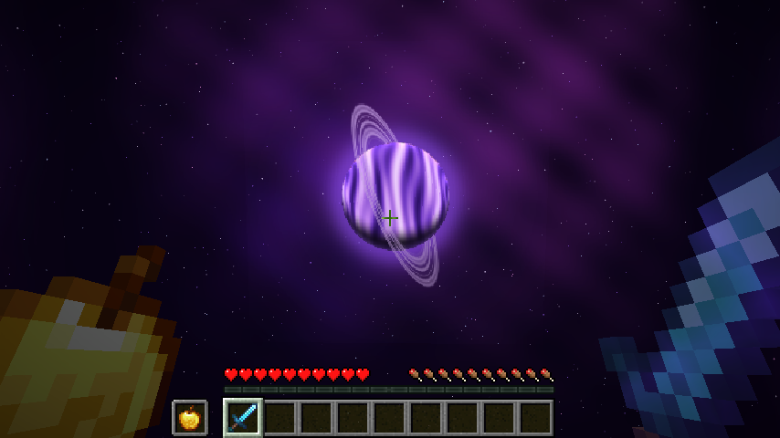

# Cosmo

made by ways, discord: waystobe

a purple space theme on top of the crystal universals cpvp base.

- moon is a ringed purple planet with all 8 phases, animated
- sun is a pulsing purple star
- night sky has a tinted shader sky and tinted twinkling stars
- extra night sky with a nebula, four blinking star layers and a ringed planet (needs the Nuit mod, works even with sodium extra's sky turned off)

from crystal universals:
- low fire: fire blocks are only a few pixels high
- no fire on screen: the burning overlay is transparent
- smaller totem particles and smaller potion particles
- every particle except totem, potion, firework and crit is turned off (block break dust and item crumbs are drawn from block and item textures, a pack can not turn them off)
- smaller totem pop on screen (the item that flashes in the middle is 30% size, item frames with a totem are smaller too)
- half full bright: the light level never goes under 65%
- enchantment levels show as 1, 2, 3 instead of I, II, III (potion levels too)
the enchant glint textures are not part of this pack. they belong to Lioren ('Old Enchant Glint Plus'). to get that glint, put that pack above this one.

version: minecraft 1.21.11 (pack format 75)

