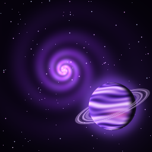
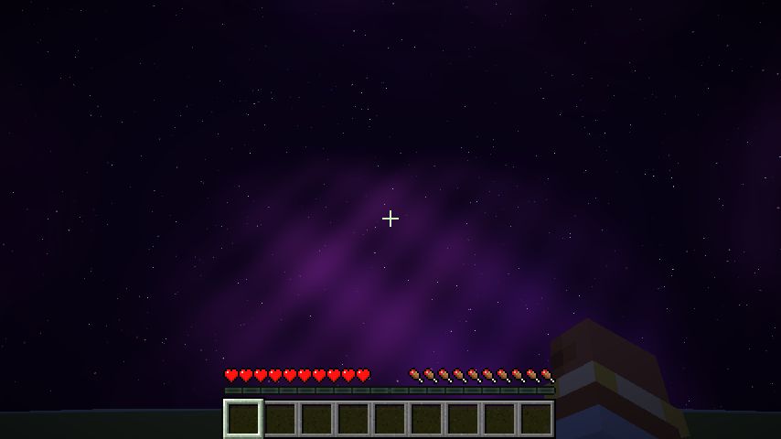
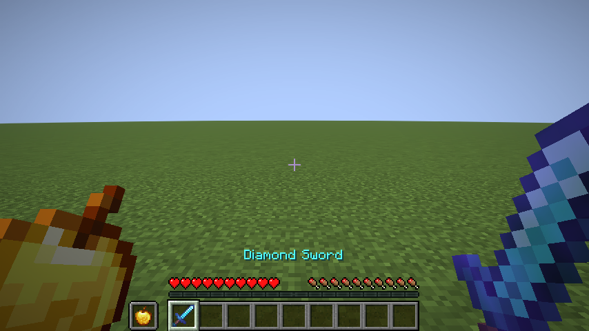
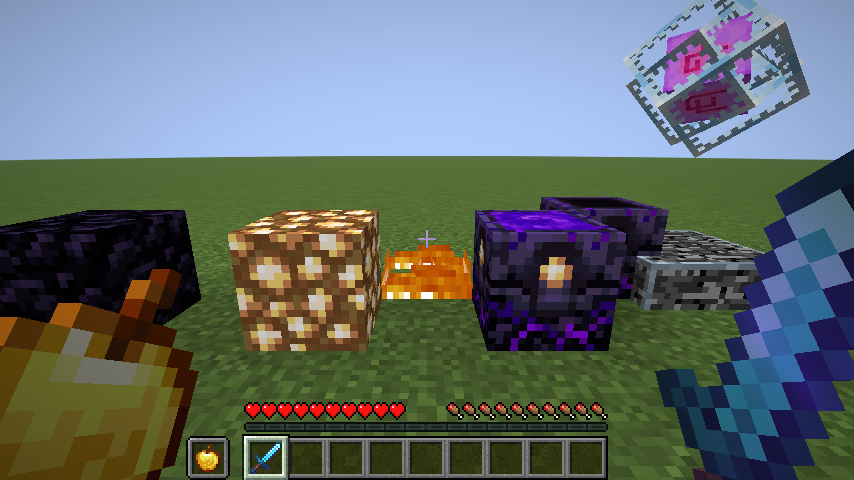
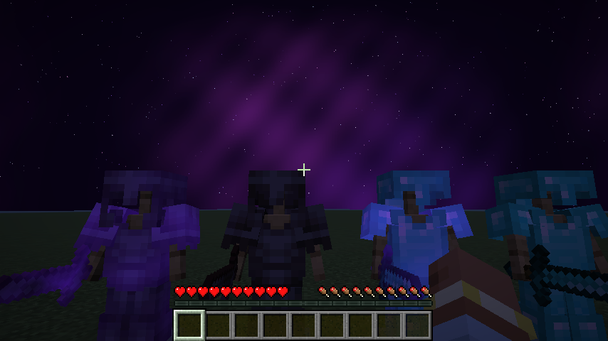

# Cosmo

made by ways, discord: waystobe

a purple space theme on top of the crystal starting textures cpvp base.

- moon is a ringed purple planet with all 8 phases, animated
- sun is a pulsing purple star
- night sky has a tinted shader sky and tinted twinkling stars
- extra night sky with a nebula, four blinking star layers and a ringed planet (needs the Nuit mod, works even with sodium extra's sky turned off)

from crystal starting textures:
- low fire: fire blocks are only a few pixels high
- no fire on screen: the burning overlay is transparent
- smaller totem particles and smaller potion particles
- every particle except totem, potion, firework and crit is turned off (block break dust and item crumbs are drawn from block and item textures, a pack can not turn them off)
- smaller totem pop on screen (the item that flashes in the middle is 30% size, item frames with a totem are smaller too)
- lighting is left on default, so brightness and fullbright mods work
- enchantment levels show as 1, 2, 3 instead of I, II, III (potion levels too)

version: minecraft 1.21.11

